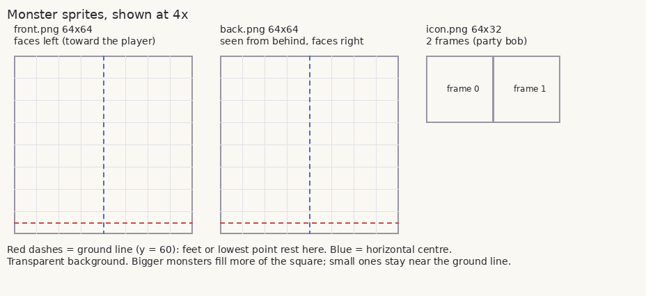
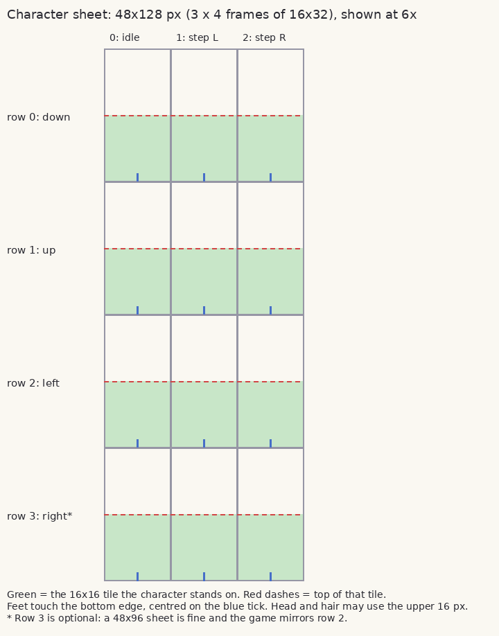
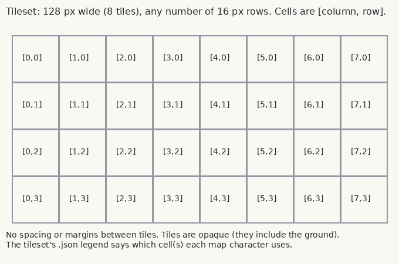
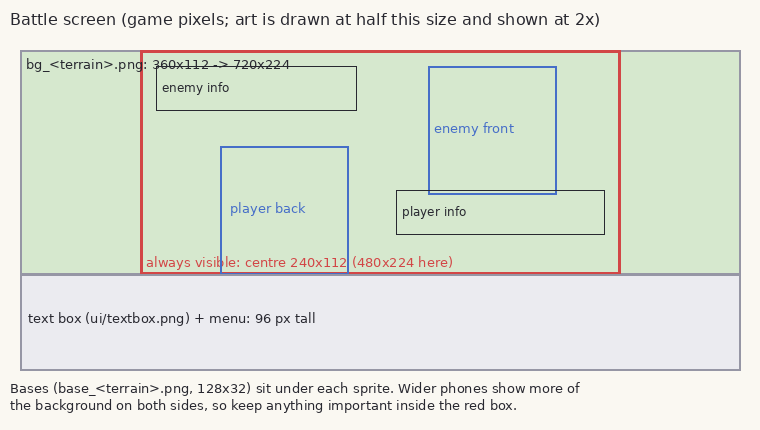
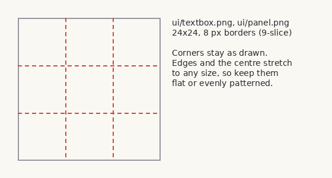

# Monstros art specification

This document defines the format for every piece of artwork in Monstros. Drop files that follow it into
`assets/` and the game uses them right away. No code changes are needed. Anything not delivered yet
keeps its coloured placeholder, so art can arrive a piece at a time.

**What's needed, and what's done:** [ART_CHECKLIST.md](ART_CHECKLIST.md). It's generated from the game
data, so it lists every monster, character, trainer and tileset the game currently uses.

## Quick reference

| Asset | File (inside `assets/`) | Size (px) | Layout |
|---|---|---|---|
| Monster, front | `monsters/<species>/front.png` | 64×64 | Faces left; feet on y = 60 |
| Monster, back | `monsters/<species>/back.png` | 64×64 | Seen from behind |
| Monster, party icon | `monsters/<species>/icon.png` | 64×32 | 2 frames of 32×32 |
| Overworld character | `characters/<sprite>.png` | 48×128 (or 48×96) | 3 columns × 4 rows of 16×32 |
| Player running | `characters/player_run.png` | 48×128 (or 48×96) | As above |
| Overworld object | `objects/<object>.png` | 16×16 | One tile |
| Trainer portrait | `trainers/<portrait>.png` | 64×64 | Faces left |
| Player in battle | `trainers/player_back.png` | 64×64 | Seen from behind |
| Tileset | `tiles/<tileset>.png` + `tiles/<tileset>.json` | 128 × (16·n) | 16×16 grid + legend |
| Battle background | `battle/bg_<terrain>.png` | 360×112 | Centre 240 px always visible |
| Battle ground base | `battle/base_<terrain>.png` | 128×32 | Ellipse under each monster |
| Text box / menu frame | `ui/textbox.png`, `ui/panel.png` | 24×24 | 9-slice, 8 px borders |
| Type badge | `ui/types/<type>.png` | 32×16 | |
| Status badge | `ui/status/<status>.png` | 24×8 | |
| Title logo | `ui/title_logo.png` | up to 240×80 | |
| App icon | `icon/icon.png` | 192×192 | |
| Adaptive icon (Android) | `icon/adaptive_foreground.png`, `icon/adaptive_background.png` | 432×432 | Keep the subject in the centre 288×288 |
| Font | `fonts/main.ttf` | TTF/OTF | Pixel font, readable at 12 px |

The tests reject delivered files with the wrong dimensions (`godot --headless -s tests/run_tests.gd`).

## General rules

- **Format:** PNG, RGBA, 8 bits per channel. Transparent pixels must be fully transparent (alpha 0).
- **Draw at 1×, GBA scale.** The game scales everything up with nearest-neighbour filtering: 2× on the
  480×320 base screen, more on a phone. Don't pre-scale, and don't anti-alias edges against the background.
  Inside a sprite, any shading is fine.
- **Palette (recommended):** at most 15 colours plus transparency per sprite, as on the GBA. This keeps
  things cohesive but isn't enforced.
- **Style:** light from the top-left, a 1 px dark outline (not pure black) around characters and monsters.
- **No semi-transparency** except for genuine effects. Shadows are drawn by the game when needed.
- **Names:** lowercase `snake_case`, exactly matching the IDs in the data files (see each section).
- **Originality:** all art must be original and must not trace, recolour or closely imitate any
  existing franchise's designs. See [CONTENT_GUIDELINES.md](CONTENT_GUIDELINES.md). Whoever delivers
  art must own it and agree to it being used in the game.

## Monsters

`assets/monsters/<species>/` where `<species>` is the key in `data/species.json` (e.g. `emberkit`).



- **`front.png`, 64×64:** the opponent's view. The monster faces **left**, towards the player's side.
  The lowest point (feet, base of the body) rests on the **ground line at y = 60**, roughly centred.
  Small monsters stay small: don't fill the square just because it's there.
- **`back.png`, 64×64:** the player's own monster, seen from behind or over the shoulder, facing right
  and into the screen. Same ground line. It's shown larger and lower on screen than the front sprite.
- **`icon.png`, 64×32:** two 32×32 frames side by side, for the party screen (the frames alternate to
  make it bob). Usually a simplified, chunkier version of the monster.
- Evolutions are separate species with their own folders.

## Overworld characters

`assets/characters/<sprite>.png`. `<sprite>` is the `"sprite"` value on an NPC in `data/maps/*.json`, or
`player` / `player_run`.



- Each frame is **16×32**: the character stands on one 16×16 tile (the bottom half of the frame), and
  the head and hair may rise into the 16 px above it.
- **Columns:** `0` idle, `1` step with the left foot, `2` step with the right foot. The game shows a step
  frame while moving and alternates them each step.
- **Rows:** `0` facing down (towards the camera), `1` up, `2` left, `3` right.
- **48×96 is also accepted:** leave out the right-facing row and the game mirrors the left row. Only do this
  if the character is symmetrical, or the asymmetry (a bag on one shoulder, a parting) doesn't matter.
- Feet touch the bottom edge of the frame, centred horizontally.
- `player_run.png` uses the same layout, with a running pose. Optional: without it, the walking sheet is used.

## Overworld objects

`assets/objects/<object>.png`, 16×16. `<object>` is the `"object"` value on a map NPC (e.g. `capture_orb`).
Objects don't turn, so there is one frame. Transparent background: the floor tile shows through.

## Trainer portraits

`assets/trainers/<portrait>.png`, 64×64. `<portrait>` is the `"portrait"` value in `data/trainers.json`.
Trainers of the same class share a portrait (`schoolkid`, `climber`, ...). Leaders and story characters get their own.
Full or three-quarter body, facing **left**, with feet or lower edge near the bottom. It's shown where the
opponent's monster appears, before they send it out. `player_back.png` is the player seen from behind,
shown on the player's side before the first monster comes out.

## Tiles

Each map uses one tileset: `outdoor` or `indoor` by default, or the map's `"tileset"` field.



- `tiles/<tileset>.png`: **128 px wide** (8 tiles) and any multiple of 16 px tall. 16×16 tiles,
  no spacing or margins. Tiles are opaque and include their own ground.
- `tiles/<tileset>.json`: the **legend**, saying which cell each map-layout character uses. Cells are
  `[column, row]`, counting from 0:

```json
{
  "tiles": {
    ".": { "cells": [[0, 0], [1, 0], [2, 0]], "mode": "random" },
    "p": { "cell": [3, 0] },
    "g": { "cell": [4, 0] },
    "w": { "cells": [[0, 1], [1, 1], [2, 1], [3, 1]], "mode": "animate", "fps": 4 }
  }
}
```

- `"cell"`: one tile.
- `"cells"` with `"mode": "random"`: variants, picked per position (stable, not flickering). Good for grass and floors.
- `"cells"` with `"mode": "animate"`: frames played in order at `"fps"`. Good for water and flowers.
- Characters missing from the legend keep their placeholder drawing.

Map-layout characters to cover (from `scripts/overworld/map_rules.gd`):

| Outdoor | | Indoor | |
|---|---|---|---|
| `.` ground | `r` red roof | `_` floor | |
| `p` path | `R` blue roof | `X` wall | |
| `f` flowers | `G` brown roof | `b` shelf / bookcase | |
| `g` tall grass | `#` building wall (with window) | `t` table | |
| `T` tree | `D` door | `k` counter (people talk across it) | |
| `w` water | `=` fence | `m` exit mat | |
| `S` sign | | | |

**Current limitation:** maps are still drawn one cell per character, so a roof is the same tile
repeated. Larger multi-tile art (2×2 trees, house fronts with corners, eaves and chimneys) can already
be drawn on the same 16 px grid in the tileset. It will be used once maps move to Godot TileMaps
(on the roadmap), and the tileset PNG won't need to change.

## Battle



The battle field is the top 224 px of the screen (112 px of art at 2×), with the text box and menu below.

- **`battle/bg_<terrain>.png`, 360×112:** the backdrop. The centre 240×112 is always visible. Wider
  phones (20:9) show up to the full 360 px, so extend the scenery to the edges, but keep anything
  important in the centre. Terrains: `grass` (outdoor maps), `indoor`, and per-map overrides such as
  `gym_stone` (the map's `"battle_terrain"` field).
- **`battle/base_<terrain>.png`, 128×32:** the ground ellipse each monster stands on, with a transparent
  background. The same image is used on both sides.

## Interface



- **`ui/textbox.png` and `ui/panel.png`, 24×24, 9-slice with 8 px borders:** the corners stay as drawn,
  and the edges and centre stretch, so keep them flat or evenly patterned. **Text is drawn in dark grey
  (`#303038`), so the interior must be light.** `textbox` frames dialogue and battle messages. `panel`
  frames menus and the battle HP boxes.
- **`ui/types/<type>.png`, 32×16:** type badges, using the type IDs in `data/types.json`
  (`flame`, `water`, ...), with the type name lettered on. Planned: not shown yet.
- **`ui/status/<status>.png`, 24×8:** `burn`, `poison`, `paralysis`, `sleep`, `freeze`. Planned.
- **`ui/title_logo.png`, up to 240×80:** the "Monstros" logo, shown at 2× on the title screen.
- **`fonts/main.ttf`:** a pixel font under the OFL or a similarly permissive licence. Include the licence file
  next to it. UI text renders at 12 px on the 480×320 screen, so choose a font designed for that size,
  or 6 px designed for 2×.
- **App icons:** `icon/icon.png` (192×192), plus Android adaptive layers `icon/adaptive_foreground.png`
  and `icon/adaptive_background.png` (432×432 each; Android crops to a circle or squircle, so keep the
  subject inside the centre 288×288). Set them in the Android export preset under *Launcher Icons*.

## Delivering art

**Monster sprites** can be delivered named by roster number (see [ROSTER.md](ROSTER.md)):
`001_front.png`, `001_back.png`, `001_icon.png`. Put them in `incoming/sprites/` and run
`python3 tools/import_sprites.py` (add `--dry-run` to preview). It checks each file's size, moves it to
`assets/monsters/<id>/`, and leaves any problem files in the inbox with the reason. Roster numbers are
fixed in `docs/roster.json` and don't change when monsters are added.

**Everything else**, or monster sprites placed by hand:

1. Name the file as in the checklist and put it in the matching `assets/` folder.
2. Run the tests: `godot --headless -s tests/run_tests.gd`. Wrong sizes and broken tileset legends are reported.
3. Regenerate the checklist: `godot --headless -s tools/art_checklist.gd`.
4. Open the project in Godot once so it imports the new files, then play. The game picks the art up automatically.

The diagrams in `docs/art/` are generated by `python3 tools/make_art_diagrams.py`.
